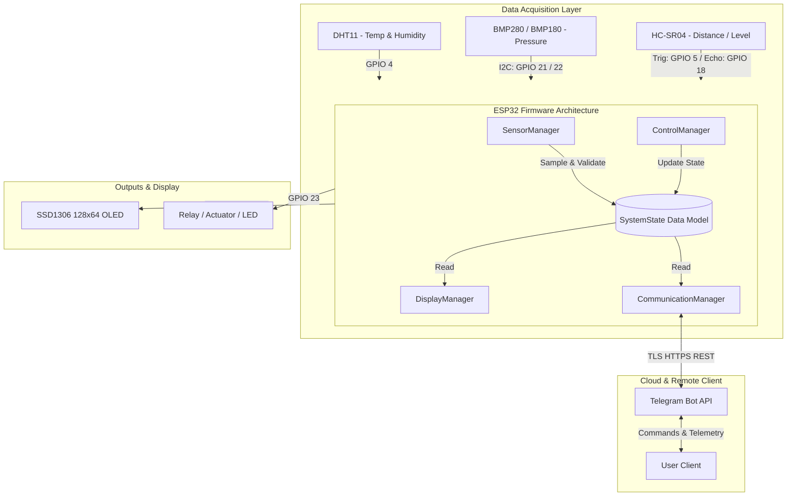

# ESP32-Based Remote Monitoring & Control System

An industrial-style prototype demonstrating embedded systems architecture, sensor acquisition, local OLED visualization, non-blocking cooperative multitasking, encrypted TLS wireless communication, and bi-directional remote device telemetry & control via the Telegram Bot API.

---

## 🌟 Key Highlights

- **Modular Architecture**: Decoupled subsystem managers (`SensorManager`, `DisplayManager`, `ControlManager`, `CommunicationManager`) centered around a unified `SystemState` data model.
- **Non-Blocking Multitasking**: Event-driven scheduling via `millis()` timers—eliminates CPU stalls caused by delays or network latency.
- **Fail-Safe Actuation**: Deterministic default boot state with confirmation loopback.
- **Multi-Sensor Telemetry**:
  - Ambient Temperature & Relative Humidity (DHT11)
  - Barometric Pressure & Altitude Estimation (BMP280 / BMP180)
  - Distance & Tank Level Monitoring (HC-SR04 with safe logic level conversion)
- **Local Diagnostics**: Real-time 128x64 SSD1306 OLED display with network and actuator badges.
- **Remote HTTPS Telemetry**: End-to-end encrypted Telegram Bot integration with interactive command parsing and automatic Wi-Fi reconnect watchdogs.

---

## 📐 System Architecture



---

## 🔌 Circuit Pinout & Wiring

| Peripheral | Pin Name | ESP32 GPIO | Logic Level | Supply Voltage | Wiring Notes |
| :--- | :--- | :--- | :--- | :--- | :--- |
| **I2C Bus** | SDA | **GPIO 21** | 3.3V | 3.3V | Shared between OLED & BMP280/180 |
| **I2C Bus** | SCL | **GPIO 22** | 3.3V | 3.3V | Shared between OLED & BMP280/180 |
| **DHT11** | DATA | **GPIO 4** | 3.3V | 3.3V | 4.7kΩ–10kΩ pull-up to 3.3V |
| **HC-SR04** | TRIG | **GPIO 5** | 3.3V | 5.0V (VIN) | Direct connection |
| **HC-SR04** | ECHO | **GPIO 18** | **3.3V (Divided)** | 5.0V out | **Requires Voltage Divider!** |
| **Actuator / LED** | CTRL | **GPIO 23** | 3.3V | 3.3V / 5.0V | 220Ω resistor to LED or Relay Module |
| **Status LED** | Onboard | **GPIO 2** | 3.3V | Built-in | Internal state mirror |

### Ultrasonic Echo Voltage Divider
Because standard HC-SR04 sensors output a 5V echo pulse, a resistor divider is mandatory to safeguard the ESP32:
```
  HC-SR04 ECHO (5V Out) ─── [1 kΩ] ───┬─── ESP32 GPIO 18 (3.3V)
                                       │
                                     [2 kΩ]
                                       │
                                      GND
```

---

## 🚀 Getting Started

### 1. Library Dependencies
Install the following via Arduino IDE Library Manager:
- `Adafruit SSD1306` & `Adafruit GFX Library`
- `Adafruit BMP280 Library` (or `Adafruit BMP085 Library`)
- `DHT sensor library` by Adafruit
- `UniversalTelegramBot` by Brian Lough
- `ArduinoJson` (v6.x or v7.x)

### 2. Telegram Bot Configuration
1. Message `@BotFather` on Telegram and create a `/newbot`.
2. Save the API Token provided.
3. Open `Config.h` and update:
   ```cpp
   #define WIFI_SSID           "Your_WiFi_SSID"
   #define WIFI_PASSWORD       "Your_WiFi_Password"
   #define BOT_TOKEN           "Your_Telegram_Bot_Token"
   ```

### 3. Flash to ESP32
Open `exp32_remote_based-monitoring.ino` in Arduino IDE, select your board (`ESP32 Dev Module`) and COM port, then click **Upload**.

---

## 💬 Telegram Command Reference

| Command | Action |
| :--- | :--- |
| `/status` | Complete environmental and actuator telemetry snapshot |
| `/temperature` | Current ambient temperature (°C) |
| `/humidity` | Relative humidity (%) |
| `/pressure` | Barometric pressure (hPa) & estimated altitude (m) |
| `/distance` | Measured ultrasonic distance / liquid level (cm) |
| `/on` | Turn actuator / relay / LED ON |
| `/off` | Turn actuator / relay / LED OFF |
| `/toggle` | Invert current actuator state |
| `/help` | Display interactive command manual |

---

## 🛡️ Reliability & Fault Tolerance

1. **Non-Blocking Ultrasonic Read**: `pulseIn()` is bounded by a 30 ms timeout, preventing sensor disconnects from stalling the MCU.
2. **Sensor Redundancy**: If DHT11 fails or is disconnected, `SensorManager` automatically falls back to BMP280 temperature telemetry.
3. **Network Auto-Healing**: Background Wi-Fi watchdog checks link status every 10 seconds and automatically initiates reconnect sequences on disconnection.
4. **Deterministic Actuation**: Fail-safe boot guarantees the actuator is grounded upon cold start or unexpected brownout.
